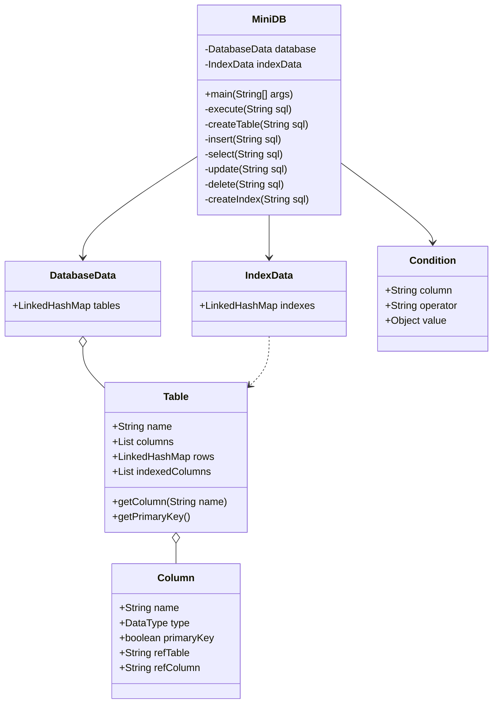
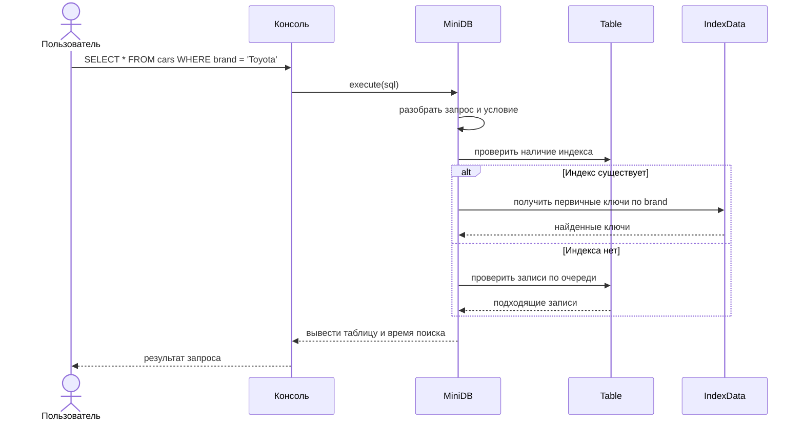

# Лабораторная работа 2. Упрощенная СУБД на Java

## 1. Что умеет программа

Программа представляет собой небольшую консольную СУБД. Она хранит несколько таблиц, проверяет первичные и внешние ключи, выполняет основные SQL-подобные команды и сохраняет данные на диск.

Реализовано:

- создание и удаление таблиц: `CREATE TABLE`, `DROP TABLE`;
- вставка одной или нескольких записей: `INSERT INTO`;
- выборка всех столбцов или указанных столбцов: `SELECT`;
- обновление записей: `UPDATE`;
- удаление записей: `DELETE`;
- первичный ключ с проверкой уникальности;
- внешний ключ с проверкой существования связанной записи;
- типы `INT`, `DOUBLE`, `STRING`, `DATE`, `BOOLEAN`;
- сохранение данных и индексов в сериализованных файлах;
- создание индекса: `CREATE INDEX`;
- использование индекса при `SELECT`, если условие относится к индексированному столбцу;
- вывод найденных записей в табличном виде и времени поиска.

Предметная область: покупатели и автомобили. Таблица `cars` связана с таблицей `customers` через внешний ключ `customer_id`.

## 2. Структура проекта

В проекте достаточно одного исходного файла:

- `MiniDB.java` - классы хранения данных, обработка SQL-команд, индексы и консольный интерфейс.
- `README.md` - описание программы и инструкция.

При первом запуске рядом с программой автоматически создаются:

- `database.dat` - сериализованные таблицы, их структура и записи;
- `indexes.dat` - сериализованные индексы.

## 3. Архитектура

### Диаграмма классов



### Диаграмма выполнения SELECT



## 4. Как запустить

Нужна установленная Java версии 8 или новее.

### Через IntelliJ IDEA

1. Создайте новый Java-проект.
2. Откройте папку `src`.
3. Создайте файл `MiniDB.java`.
4. Скопируйте в него код из файла `MiniDB.java`.
5. Запустите метод `main`.
6. В появившейся консоли вводите команды SQL по одной строке.

## 5. Пример работы

Сначала создадим таблицу покупателей:

```sql
CREATE TABLE customers (id INT PRIMARY KEY, name STRING, birth_date DATE, active BOOLEAN);
```

Затем таблицу автомобилей. `customer_id` ссылается на `customers.id`:

```sql
CREATE TABLE cars (id INT PRIMARY KEY, brand STRING, price DOUBLE, production_date DATE, electric BOOLEAN, customer_id INT REFERENCES customers(id));
```

Добавим покупателей:

```sql
INSERT INTO customers VALUES (1, 'Ivan', '2004-05-10', TRUE);
INSERT INTO customers VALUES (2, 'Anna', '2003-11-20', TRUE);
```

Добавим автомобили:

```sql
INSERT INTO cars VALUES (1, 'Toyota', 25000.0, '2020-01-01', FALSE, 1);
INSERT INTO cars VALUES (2, 'BMW', 32000.0, '2022-03-15', TRUE, 2);
INSERT INTO cars VALUES (3, 'Toyota', 18000.0, '2018-06-01', FALSE, 1);
```

Можно вставить несколько записей одной командой:

```sql
INSERT INTO cars VALUES (4, 'Audi', 27000.0, '2021-05-10', FALSE, 2), (5, 'Volvo', 29000.0, '2023-02-01', TRUE, 1);
```

Примеры запросов:

```sql
SELECT * FROM cars;
SELECT brand, price FROM cars WHERE price > 20000;
UPDATE cars SET price = 30000 WHERE id = 2;
DELETE FROM cars WHERE brand = 'Toyota';
```

Пример вставки только части столбцов. Остальные столбцы получат значение `NULL`:

```sql
INSERT INTO cars (id, brand) VALUES (6, 'BMW');
```

## 6. Индексы

Создание индекса:

```sql
CREATE INDEX idx_cars_brand ON cars (brand);
```

После этого запрос по `brand` будет использовать индекс:

```sql
SELECT * FROM cars WHERE brand = 'Toyota';
```

В сообщении после результата будет указано, использовался индекс или полный просмотр таблицы. Индекс хранит значение индексированного столбца и набор первичных ключей записей с этим значением. Для поиска по диапазону также поддерживаются операторы `>`, `<`, `>=`, `<=`.

При вставке, обновлении и удалении программа перестраивает индексы и сохраняет их в `indexes.dat`. Поэтому после перезапуска они остаются доступными.

## 7. Поддерживаемые форматы запросов и ограничения

Поддерживаются следующие типы столбцов:

| Тип | Пример значения |
|---|---|
| `INT` | `25` |
| `DOUBLE` | `1250.50` |
| `STRING` | `'Toyota'` |
| `DATE` | `'2024-10-15'` |
| `BOOLEAN` | `TRUE` или `FALSE` |

Дата вводится в формате `ГГГГ-ММ-ДД` и заключается в одинарные кавычки.

В условии `WHERE` поддерживается одно сравнение: `=`, `!=`, `<>`, `>`, `<`, `>=`, `<=`. Логические связки `AND` и `OR`, соединение таблиц через `JOIN`, сортировка `ORDER BY` и агрегатные функции не реализованы. В `CREATE TABLE` поддерживается один первичный ключ на таблицу. Изменение первичного ключа через `UPDATE` не поддерживается.

Перед удалением записи из родительской таблицы программа проверяет, не ссылаются ли на нее записи другой таблицы. Это защищает связь между покупателем и автомобилем.

## 8. Проверка работы и производительности

Проверялись создание двух связанных таблиц, вставка нескольких записей, выборка с условием, обновление, удаление, проверка повторяющегося первичного ключа, проверка внешнего ключа, создание индекса и повторный запуск программы с загрузкой сохраненных данных.

Для сравнения индекса и полного просмотра использовалась таблица из 30 000 автомобилей. Запрашивалась одна запись с редким значением `brand = 'RareBrand'`.

| Способ поиска | Время поиска в тестовом запуске |
|---|---:|
| Без индекса, полный просмотр 30 000 записей | 8.30 мс |
| С индексом по `brand` | 0.145 мс |

В этом тестовом запуске индексный поиск занял примерно в 57 раз меньше времени. Это пример одного запуска, а не универсальная гарантия: результат зависит от компьютера, размера таблицы, распределения значений и прогрева JVM. На маленькой таблице разница может быть незаметной, а создание и хранение индекса требует дополнительной памяти.

Время, которое программа выводит после каждого `SELECT`, измеряется непосредственно вокруг поиска записей. Время печати результата в это измерение не входит.

## 9. Надежность и сохранение

После операций изменения программа записывает данные и индексы в файлы. Сначала создается временный файл, затем он заменяет основной. Это снижает риск повреждения файла при обычном сохранении. При аварийном отключении между сохранением таблиц и индексов файлы могут не совпасть; если индекс отсутствует, программа создает его заново по сохраненным данным.

## 10. Вывод

В результате создана упрощенная файловая СУБД на Java. Она поддерживает основные операции над таблицами, сериализацию, первичные и внешние ключи, простой разбор SQL-подобных запросов и индексирование. Реализация предназначена для учебной демонстрации принципов хранения данных и выполнения запросов, а не для замены промышленной СУБД.

## 11. Использованные источники

- Документация Java: https://docs.oracle.com/javase/8/docs/

Работа выполнена индивидуально.
